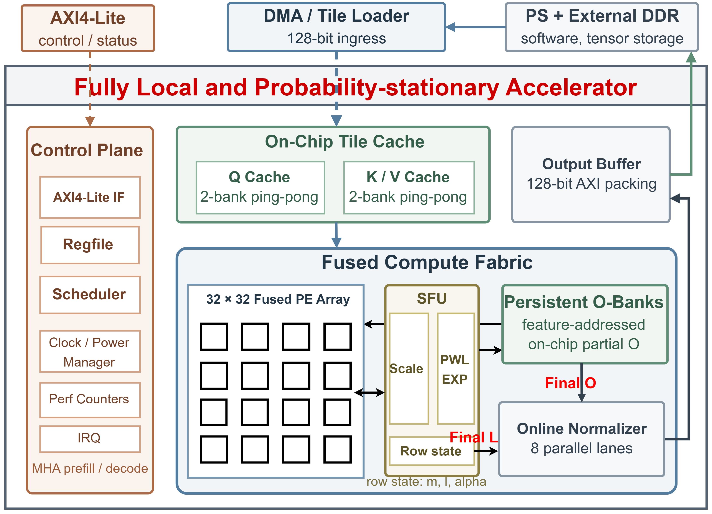

# FLOPA: Fully Local and Overlapped Probability-Stationary Attention

FLOPA is a fixed-point FlashAttention accelerator that fuses QK, online
softmax, and PV on a 32 x 32 systolic array. Scores, probabilities, row state,
and partial output remain local to the compute fabric; the design therefore
avoids round trips through a global score/probability scratchpad and overlaps
the major attention phases.

The current branch targets dense bidirectional diffusion-transformer attention.
One MAX_D=128 instance selects d at job start; the native model dimensions
are 64, 72, and 128. LLM Decode and causal masking are removed.
The VCK190/SmolLM2 results below describe the historical fixed-d=64 design,
not this new ASIC implementation. See [runtime-d RTL](docs/rtl_runtime_d.md)
for the current ABI and [implementation report](paper_test/IMPLEMENTATION_REPORT.md)
for validation and synthesis evidence.

The new instance passes 157 short UVM jobs and 66,312 byte checks. Its 28 nm TT
mapped cell area is 2.452364 mm², including 0.656747 mm² of SRAM (480 macros).
It has 28 explicit ICGs and no setup violations at the 1.60 ns target. Pre-CTS
SRAM-interface hold violations remain; this is not routed timing signoff.
Workload power and model latency for this version have not yet been measured.

## Design Point

| Item | Current implementation |
| --- | --- |
| Compute fabric | 32 x 32 fused PEs in four 8 x 32 stripes |
| Head dimension | MAX_D=128; job-snapshotted runtime d=1..128 |
| Arithmetic | signed INT8 Q/K/V and output, unsigned Q1.15 P/alpha, INT32 state |
| Softmax parallelism | 32 score-scale/PWL-exp lanes |
| Dataflow | output-stationary QK, column-overlapped online softmax, probability-stationary WS-PV |
| Local storage | PE-local score/P, persistent feature-addressed O banks, ping-pong Q/K/V cache |
| Control/input/output | AXI4-Lite, 128-bit tile loader, 128-bit AXI4 write master |
| Runtime operation | dense bidirectional MHA; one head count |



## Historical Fixed-d=64 Results

### ASIC estimate

The 28 nm TT, 0.9 V, 25 C synthesis target is 1.60 ns (625 MHz). The final
area estimate is **2,436,075.17 library units** with 480 SRAM macros. A
64 x 64 mapped-netlist `fa_random_qkv_test` run achieved 100% SAIF annotation
and zero UVM errors/fatals.

| Gate-SAIF metric | Value |
| --- | ---: |
| Cell internal power | 630.4358 mW |
| Net switching power | 18.1893 mW |
| Dynamic power | **648.6251 mW** |
| Leakage power | **9.8584 mW** |
| Total power | **658.4835 mW** |
| Workload throughput | 76.58 GMAC/s (153.16 GOPS at 2 ops/MAC) |
| Energy efficiency | 8.60 pJ/MAC, 0.233 TOPS/W |

These are mapped, pre-layout estimates. Exact workload and reporting
conventions are defined in [PPA and Optimization](docs/ppa_and_optimization.md).

### VCK190 board result

The routed design operates at **170.019 MHz** on an AMD VCK190 and meets timing
with setup WNS/TNS of `0.012/0.000 ns`. The final board
smoke test passed twice with 2,942 accelerator cycles, zero stall cycles, and
zero errors. SmolLM2-135M-Instruct uses two Cortex-A72 threads and software
GQA-to-MHA expansion for the current MHA hardware interface.

| Routed system resource | Used | Device utilization |
| --- | ---: | ---: |
| LUT | 294,718 | 32.75% |
| FF | 295,111 | 16.40% |
| BRAM tile | 6.5 | 0.67% |
| URAM | 96 | 20.73% |
| DSP58 | 1,220 | 61.99% |

| Sequence | Attention-core speedup | Callback speedup | Full-prefill speedup |
| ---: | ---: | ---: | ---: |
| 64 | **19.762x** | 1.410x | 1.008x |
| 1024 | **9.378x** | 3.865x | 1.185x |

PS conversion and packing dominate the short-sequence callback; native GQA,
layout fusion, and reducing repeated external K/V traffic are the principal
next integration optimizations. Board power and Re10K measurements remain to
be collected.

## Result Locations

| Result | Repository path |
| --- | --- |
| Design Compiler configuration, QoR, area, resource, timing, and check reports | `asic/dc/work/synth/tt/system/attention_accel_top/reports/` |
| ASIC PPA and gate-SAIF interpretation | `docs/ppa_and_optimization.md` |
| FPGA board evaluation report | `fpga/docs/final_report_material.md` |
| Sequence-64/1024 raw FPGA JSON, logs, and hashes | `fpga/model/results/` |
| Vivado synthesis, routed timing, utilization, DRC, methodology, clock, and power-container reports | `fpga/vivado/build/reports/` |

The compact DC and Vivado `reports/` trees are intentionally allowed by
`.gitignore` so accepted implementation evidence can be versioned. DDC,
netlist, checkpoint, bitstream, simulator, waveform, SAIF, and general EDA
work products remain ignored.

## Documentation

| Document | Purpose |
| --- | --- |
| [Technical Report](docs/design_specification.md) | algorithm, architecture, storage, dataflow, and final results |
| [Register and Interface Reference](docs/register_and_interface_reference.md) | register table, interfaces, protocols, and programming sequence |
| [PPA and Optimization](docs/ppa_and_optimization.md) | ASIC/FPGA PPA, throughput, power, and optimization analysis |
| [Verification Report](docs/verification_report.md) | regression, coverage, gate workload, and waveform guidance |
| [RTL Code Guide](docs/rtl.md) | implementation walkthrough from top level to each datapath |
| [Submission Checklist](docs/submission_checklist.md) | competition requirement traceability and packaging status |
| [FPGA Evaluation](fpga/docs/final_report_material.md) | reproducible VCK190 and SmolLM2 measurements |

## Repository Layout

```text
rtl/                  Synthesizable RTL.
  common/             Constants, pipelined arithmetic, and timing helpers.
  control/            Register file, scheduler, controller, and counters.
  axi/                AXI4-Lite control and AXI4 writeback.
  compute/            Fused PE/stripe, QK/PV engines, and scale pipeline.
  softmax/            PWL exponential, reciprocal, and final normalizer.
  memory/             Ping-pong cache, persistent O banks, output buffer.
tb/module_tb/         Directed self-checking module tests with default FSDB.
tb/uvm/               UVM agents, tests, reference model, and coverage.
tb/sim/               Simulation Makefile, filelists, and coverage scripts.
asic/                 DC/Power Compiler scripts, constraints, and SRAM setup.
fpga/                 VCK190 Vivado/Vitis flow, host code, model tests, results.
figures/              Maintained architecture and dataflow figures.
docs/                 Contest-facing reports and implementation references.
ppt/                  Defense presentation outline.
```

Generated simulation and EDA work directories are excluded from the source
package. Raw board JSON/log evidence under `fpga/model/results/` is retained.

## Reproduction

Prerequisites are VCS V-2023.12-SP2 or compatible, Design Compiler/Power
Compiler V-2023.12-SP5, Vivado/Vitis 2023.1 for VCK190, GNU Make, and the
28 nm libraries configured below `/data/public`.

Run the short functional suite from the repository root:

```bash
RUNTIME_D_OUT_DIR="$PWD/tb/sim/build/runtime_d_current" make runtime-d-smoke
```

Use a fresh output directory to preserve the archived synthesis-authorizing
build and logs. The suite uses one compiled simulator and short sequences. It checks native
dimensions, configuration switches, tails, multiple heads, output strobes,
and numerical data. See `docs/uvm_runtime_d.md` for exact coverage and logs.
The old 21-run/23-module results below belong to the historical ABI.

After the tested RTL/UVM/configuration is committed and its validation manifest
is created, synthesize the same source with:

```bash
make synth-verified CLOCK_PERIOD=1.6
```

The manifest binds passing logs to their SHA256 and source commit. New results
are stored in `asic/dc/work/synth/tt/diffusion_runtime_d/attention_accel_top/`;
the old `system/` reports are retained as the historical baseline. Automatic
clock-gate insertion remains disabled; the final mapped design has 28 RTL ICGs.
`power.rpt` without a new activity trace is a vectorless estimate, not gate-SAIF
workload power. No new long-sequence gate simulation is required by this suite.

For the FPGA build and board run, follow [fpga/vitis/README.md](fpga/vitis/README.md)
and [fpga/model/README.md](fpga/model/README.md). The Vitis collateral retains
the legacy `dit_fa_*` filename prefix; it identifies FLOPA artifacts and does
not denote a second architecture.

## Historical Verification Status

All 21 fixed-seed UVM runs pass with zero errors/fatals. Functional coverage is
100.00%; raw full merged coverage is 95.66%, raw `tb_top` coverage is 95.01%,
and reviewed DUT-scoped coverage is 96.00%. Directed module coverage completes
23/23 jobs. Prefill is checked through 512 x 512 and MHA decode through one
query by 256 KV tokens.

## Current Boundaries

- The RTL input boundary is a 128-bit tile-loader stream; the VCK190 design
  supplies the external mover/DMA wrapper.
- Native GQA is not implemented. The legacy board software expands KV heads;
  that software targets ABI v2 and must be adapted before use with ABI v3.
- FPGA board power and Re10K board results are not yet measured.
- ASIC figures are synthesis/gate-activity estimates, not placed-and-routed or
  silicon measurements.
